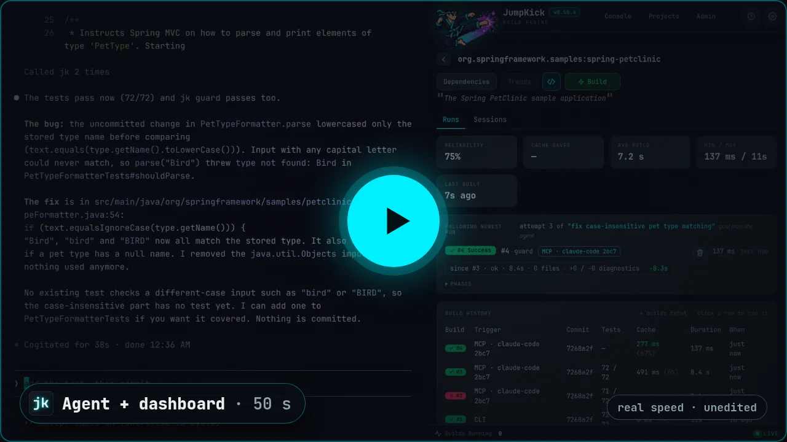
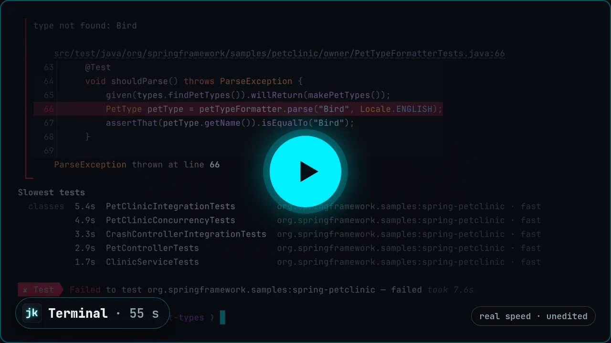

# The agentic workbench for Java.

[](LICENSE)
[](https://openjdk.org/projects/jdk/25/)
[](https://www.graalvm.org/)
[](docs/user/README.md)

**The fastest recompiles. The fastest re-tests. An agent that understands your code.**

**JumpKick** (CLI: **`jk`**) brings code intelligence, builds, tests, and live feedback into one
integrated toolkit. Give your coding agent the tools to move faster — and see exactly what it's
doing.

```bash
curl -fsSL https://jumpkick.build/install.sh | bash     # Windows: irm https://jumpkick.build/install.ps1 | iex

jk new my-app && cd my-app
jk add jackson3-databind
jk test
jk web        # watch every build, test, and agent run live
```

`jk new` wires your agent in for you: Claude Code, Cursor, VS Code, Gemini CLI, and opencode. On
an existing project, run `jk agents`.

Open source. Apache 2.0. Java, Kotlin, and Groovy. **[jumpkick.build](https://jumpkick.build)**

## See it move

<p align="center">
  <a href="https://jumpkick.build/#demo-agent"></a>
  <a href="https://jumpkick.build/#demo-terminal"></a>
</p>

<p align="center"><b>Your agent fixes it</b>, and the dashboard follows every run · <b>You fix it</b>, red to green from the terminal</p>

---

## Spend your time making progress. Not waiting for it.

### Change the code. Get the answer. Keep moving.

Lightning-fast recompiles and re-tests keep your development loop moving. Every step is keyed by
the content of its inputs, so a second branch, worktree, agent, or CI run reuses the work instead
of starting over. Never type `clean` again.

### Give your agent understanding — not another search expedition.

Built-in semantic navigation and MCP connect your agent directly to your code and development
tools. Find callers. Follow relationships. Rename a method and every caller in one step. Make
informed changes.

<!-- agents-claims:begin -->
We asked coding agents from 6 vendors questions like "who calls this method?" With JumpKick's code graph, they answered in **66–91% fewer back-and-forth turns** and used **72–98% fewer tokens** than without it. Renaming a method everywhere it is used took **75–91% fewer turns** and **78–98% fewer tokens**. The graph pays off even on tiny projects: the smallest we tested, gs-multi-module, has just **83 lines of code**. ([The tables](docs/user/why.md#asking-about-the-code).)
<!-- agents-claims:end -->

### Know what's happening. Know what's next.

Accurate progress and a live dashboard put builds, tests, failures, and recovery in view. `jk web`
shows every run, who asked for it, what changed since the last attempt, and why it failed. Catch a
wrong turn before it becomes another wasted session.

### Build your application. Not your build system.

Readable configuration. Managed JDKs. Built-in code generation, packaging, native executables, and
containers. One coherent toolkit — not another integration project.

```toml
# jk.toml — the whole build. Data, not a program.
group   = "com.example"
name    = "my-app"
version = "0.1.0"
java    = 25

[dependencies]
jackson3-databind = "3.0.0"

[platform-dependencies]
spring-boot-dependencies = "4.1.0"
```

### Bring your project. Leave the friction behind.

Import your Maven or Gradle build. Let your agent handle the finishing touches. Get back to
building. Already on Maven? `cd` into the project and run `jk test` — no `jk.toml` needed.

---

## At a glance

| | **JumpKick** | **Maven** | **Gradle** |
|---|---|---|---|
| Build file | TOML data | XML | Kotlin / Groovy program |
| Lockfile | Always, with checksums | None | Opt-in verification |
| Agent I/O | Results file, MCP, code graph | Log scrape | Log scrape |
| Work avoidance | Content-addressed action cache, on by default | Recompiles | Build cache, opt-in |
| Between builds | One capped engine for every project | Nothing resident | A daemon per build environment |
| Supervision | Live dashboard of every agent run | — | Build scans (hosted) |
| Migration | `jk mvn`, `jk import`, `jk export` | — | — |

The full story, with the numbers behind every claim: **[Why JumpKick](docs/user/why.md)** ·
**[Performance](docs/user/performance.md)** · **[Comparison](docs/user/comparison.md)**.

---

## Your agent is ready to move faster. Give it a JumpKick.

| Doc | For |
|---|---|
| [**Getting started**](docs/user/getting-started.md) | Install, first project, first build |
| [**User documentation**](docs/user/README.md) | People and coding agents *using* JumpKick |
| [**Agents**](docs/user/agents.md) / [**MCP**](docs/user/mcp.md) / [**Skill**](docs/user/skill.md) | How agents talk to `jk` |
| [**Migration**](docs/user/migration.md) | From Maven or Gradle |
| [**Security**](docs/user/security.md) | Report a vulnerability; trust boundaries |
| [**Contributor documentation**](docs/contributors/README.md) · [**Contributing**](CONTRIBUTING.md) | Changing JumpKick itself |

## Status

**Alpha (pre-1.0).** Core resolve, build and test are real and dogfooded: JumpKick builds, tests,
guards, installs and releases itself. APIs and the lock schema may change until 1.0. What 1.0 means:
**[the 1.0 plan](docs/contributors/plan-1.0.md)**.

Running `jk` needs JDK 25+, and `jk` installs one if the machine has none. Projects target any
`java =` level from 8 up.

## License

[Apache 2.0](LICENSE).
