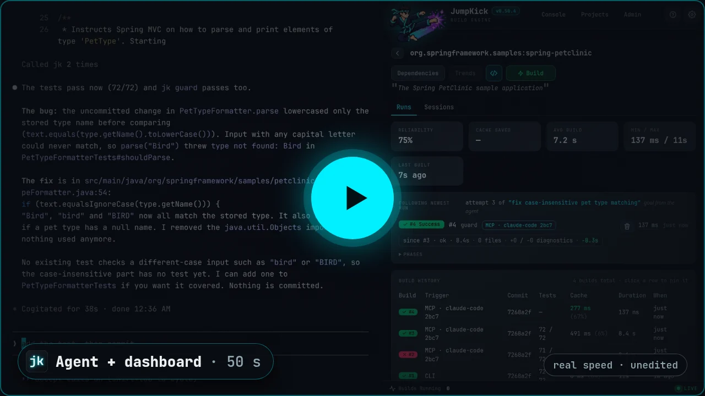
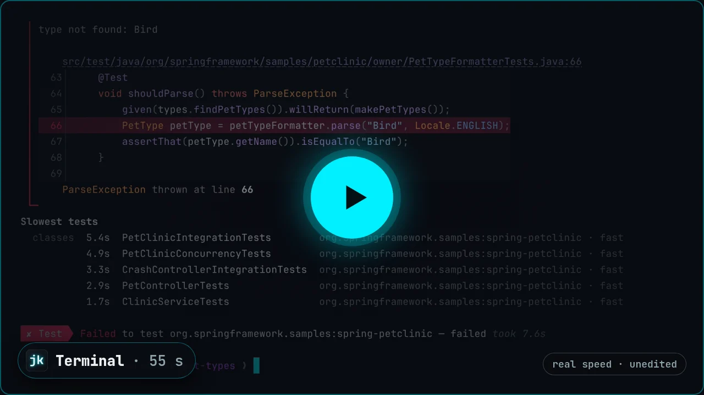

# JumpKick: the Agent Workbench for Java

[](LICENSE)
[](https://openjdk.org/projects/jdk/25/)
[](https://www.graalvm.org/)
[](docs/user/README.md)

**Put your coding agent on rails.**

**JumpKick** (CLI: **`jk`**) is everything a coding agent needs to work in a Java codebase: a
compiler-exact code graph, safe refactoring, builds and tests that redo only what a change
invalidated, guards, and every toolchain. One fast, right way to do each common thing, so your
agent does more and gets less wrong. You get a live view of what it is doing.

```bash
curl -fsSL https://jumpkick.build/install.sh | bash     # Windows: irm https://jumpkick.build/install.ps1 | iex

jk new my-app && cd my-app
jk add jackson3-databind
jk test
jk web        # watch every build, test, and agent run live
```

On Windows, the [Windows setup guide](docs/user/windows.md) gets a stock Windows 11 machine building
fast: Smart App Control, Defender, where to keep code, and the optional Dev Drive.

`jk new` wires your agent in for you: Claude Code, Cursor, VS Code, Gemini CLI, and opencode. On
an existing project, run `jk agents`. Any other agent takes one command: `jk mcp`.

Open source. Apache 2.0. Java, Kotlin, and Groovy. **[jumpkick.build](https://jumpkick.build)**

## See it move

<p align="center">
  <a href="https://jumpkick.build/#demo-agent"></a>
  <a href="https://jumpkick.build/#demo-terminal"></a>
</p>

<p align="center"><b>Your agent fixes it</b>, and the dashboard follows every run · <b>You fix it</b>, red to green from the terminal</p>

---

## What an IDE did for you, for your agent

You could write Java in a plain text editor. You do not, because an IDE knows your code and runs
your build. Without a workbench your agent is in that text editor: grep, read, guess, rebuild,
wait. JumpKick gives it the same things as tools it can call.

| What your IDE does for you | What JumpKick does for your agent |
|---|---|
| Find usages | `usages`: every call, field use and type use, exact, in one call |
| Rename refactoring | `rename`: every use the compiler bound, proved by a compile, undone if it fails |
| Red squiggles | A verdict: each error at `file:line` with the exact line to edit |
| Run tests from the gutter | `build`: the cheapest test rung that can catch the bug, then the gate |
| Incremental build | A content-addressed cache shared by every worktree, agent and CI runner |
| Inspections | Guards: the rule, the sanctioned alternative, and why |
| New project wizard | `new`: templates that ask only for what is missing |
| SDK manager | JDKs and Node.js installed and pinned |
| | Anchors: a route, a SQL column or a config key, and every file that names it |
| | A dashboard of every agent run: who asked, what changed, why it failed |

## On rails: one fast, right way

### Understand the code in one call

A code graph is built in: calls, overrides and references from the compiled classes, so an answer
is complete, not a search result. It also knows what surrounds the code. Routes, SQL tables and
columns, configuration keys, environment variables and ports are anchors that join the Java to the
YAML, the migration, the Dockerfile and the test that name them.

<!-- agents-claims:begin -->
We asked coding agents from 6 vendors questions like "who calls this method?" With JumpKick's code graph, their answers cost **62–95% less**, $0.019–$0.079 a question instead of $0.056–$1.40 (an estimate at API list prices), and took **72–98% fewer tokens** and **66–91% fewer back-and-forth turns** than without it. Renaming a method everywhere it is used cost **71–86% less**, $0.008–$0.060 a rename instead of $0.029–$0.395, with **78–98% fewer tokens** and **75–91% fewer turns**. The graph pays off even on tiny projects: the smallest we tested, gs-multi-module, has just **83 lines of code**. ([The tables](docs/user/why.md#asking-about-the-code).)
<!-- agents-claims:end -->

### Change it safely

`rename` renames a method, a field with its accessors, a type or a package, or moves a type, in
one call. It edits every use the compiler bound, lists the rest, proves the result by a compile
and undoes the edit if the proof fails.

### Only the work the change needs

Change one file and JumpKick recompiles what that change invalidated and re-runs the test suites
whose inputs changed. A suite nothing touched is not run again, and after a failure only the
classes that have not passed are. Every step is keyed by the content of its inputs, so a second
branch, worktree, agent or CI runner reuses the work instead of starting over, and a CI job skips
every compile, generate, guard and test step an earlier run already proved. Never type `clean`
again.

### Stay on the rails

The default test run is the cheap unit rung; `--guard` is the named bar before work is handed
back. House rules are data: a violation names the rule, the sanctioned alternative and why, so the
fix is mechanical. A dependency coordinate no repository serves is refused before anything is
written. You can leave the rails, with a script under `.jk/scripts/` or a plugin, and you will
rarely need to.

### Nothing to assemble

Readable configuration. Managed JDKs. Built-in formatting, code generation, packaging, native
executables, and containers. One coherent workbench, not another integration project.

```toml
# jk.toml — the whole build. Data, not a program.
group   = "com.example"
name    = "my-app"
version = "0.1.0"
java    = 25

[dependencies]
jackson3-databind = "3.0.0"

[platform-dependencies]
spring-boot-dependencies = "4.1.0"
```

### See what your agent is doing

`jk web` shows every run, who asked for it, what changed since the last attempt, and why it
failed. Catch a wrong turn before it becomes another wasted session.

### Bring your project

Import your Maven or Gradle build. Let your agent handle the finishing touches. Already on Maven?
`cd` into the project and run `jk test` — no `jk.toml` needed.

---

## At a glance

| | **JumpKick** | **Maven** | **Gradle** |
|---|---|---|---|
| Build file | TOML data | XML | Kotlin / Groovy program |
| Lockfile | Always, with checksums | None | Opt-in verification |
| Agent I/O | Results file, MCP, code graph | Log scrape | Log scrape |
| Work avoidance | Content-addressed action cache, on by default | Recompiles | Build cache, opt-in |
| Between builds | One capped engine for every project | Nothing resident | A daemon per build environment |
| Supervision | Live dashboard of every agent run | — | Build scans (hosted) |
| Migration | `jk mvn`, `jk import`, `jk export` | — | — |

The full story, with the numbers behind every claim: **[Why JumpKick](docs/user/why.md)** ·
**[Performance](docs/user/performance.md)** · **[Comparison](docs/user/comparison.md)**.

---

## Where it is going

More compiler-proved refactorings beyond `rename`; lookup of a library's real API at the locked
version; test selection per class from a change's cone; a ledger of what JumpKick saved you; and
JumpKick Dojo, a shared cache for teams, so nobody re-runs what CI already proved.

## Your agent is ready to move faster. Give it a JumpKick.

| Doc | For |
|---|---|
| [**Getting started**](docs/user/getting-started.md) | Install, first project, first build |
| [**User documentation**](docs/user/README.md) | People and coding agents *using* JumpKick |
| [**Agents**](docs/user/agents.md) / [**MCP**](docs/user/mcp.md) / [**Skill**](docs/user/skill.md) | How agents talk to `jk` |
| [**Code graph**](docs/user/graph.md) | Usages, anchors, rename |
| [**Migration**](docs/user/migration.md) | From Maven or Gradle |
| [**Security**](docs/user/security.md) | Report a vulnerability; trust boundaries |
| [**Contributor documentation**](docs/contributors/README.md) · [**Contributing**](CONTRIBUTING.md) | Changing JumpKick itself |

## Status

**Alpha (pre-1.0).** Core resolve, build and test are real and dogfooded: JumpKick builds, tests,
guards, installs and releases itself. APIs and the lock schema may change until 1.0. What 1.0 means:
**[the 1.0 plan](docs/contributors/plan-1.0.md)**.

Running `jk` needs JDK 25+, and `jk` installs one if the machine has none. Projects target any
`java =` level from 8 up.

## License

[Apache 2.0](LICENSE).
